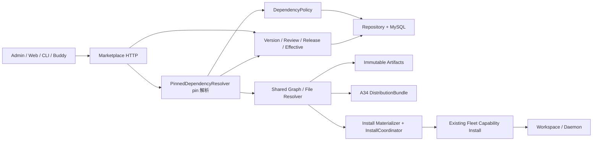

# Marketplace 独立资产引用与发布：完整技术方案（P 模型）

> **P 模型取代 B：** 本文已按《[决策修订：P 模型](decisions-20261026-pin.md)》改写。Expert→Skill、Team→Expert 以**已发布源快照中的 `target_version_id` pin** 为权威；公共读取/A01/A03/A34/安装/审核观察只读 pin，不再解析目标最新版；Connector 保持 ID + effective。文中残留的 B/latest 字样只用于历史对照，均以 P 为准。**当前 PR #139 的 B 实现（latest resolver/A01 latest SQL/A15 批准重解析/A34 动态依赖/安装 latest）必须按本文重做，不能按现状评审或合并。**

状态：**最终决策已锁定（2026-10-26 · P 模型）**。引用模型为 **P（publish-time pin）**：Expert→Skill、Team→Expert 在发布/提交时把目标**当时的当前正式发布版**冻结为源快照中的 `target_version_id` pin；此后公共读取、A03、A34、安装、审核观察只读 pin，目标发新版不改变已发布来源。草稿 pin 可为 NULL，发布/提交补齐；显式 pin 校验归属与 release；Connector 关系必须 NULL，仍按 ID + effective。A09 restore-to-draft、A29/A30 HTTP 迁移、同名/多版本共存（`mk1` 别名、`SKILL.md`/frontmatter 改写）、`installation_name` 均已撤回或明确不做；“曾发布即禁止删除”不再是本期规则；private 同 owner private→private 是合法主路径。规则以[最终决策](00-decisions.md)为准，跨服务 wire 见[API 契约](02-api-contracts.md)，执行拆分见[issues](issues/README.md)。本文与 00 冲突时以 00 为准。本文不表示源码已实现任何一条。

## 1. 目标、范围和非目标

**已确认核心：将内含资产改为独立市场资产引用；Expert→Skill、Team→Expert 保存目标 ID，并在发布/提交时冻结目标当前正式发布版为 `target_version_id` pin；读取、A34、安装、审核观察只读该 pin，不解析目标最新版；Connector 仍按 ID 引用有效态，不新增业务版本。** 保存快照、pin 冻结/校验、版本图读取、现有审核、安装、删除保护和显式迁移只围绕该模型改造；不重设计现有权限、审核、上下架、删除或 Admin 操作。

源码改造涉及 `octo-marketplace`、`octo-admin`、`octo-web`、`octo-cli`、`octo-buddy-client`；`octo-fleet` 仅作为现有原子安装服务的联调依赖，本期不修改其源码、API、数据库或清理策略。`octo-server` 继续负责身份/Space 权限；`octo-plugin-lib` 继续负责 Manifest/Package/Hash/端点类型，不修改通用 Relation Schema。Buddy Daemon 不承担市场解析，不新增工作空间绑定模型。

不包含：新增安全状态、隐藏/重新上架流程或接口、下架依赖安装豁免、新取证授权模式、运行中实例强停、自动同步已安装 MCP、团内覆盖成员能力、新 Secret 管理系统、二进制技能支持、脚本自动改写、自动执行生产迁移；也不做同名/多版本共存、A09 恢复、A29/A30 HTTP 迁移、Fleet/Daemon 改造。不支持的输入明确拒绝，不能静默损失内容。

### 1.1 市场源定义、工作空间实例与纯本地资源

- 市场发布：Expert 只能引用市场中的 Skill ID，并在发布/提交时把 Skill 当前正式发布版冻结为 `target_version_id` pin；不接受本地路径或 Fleet skill_id 替代市场身份。要发布含本地 Skill 的组合，先将 Skill 显式发布到市场，再发布引用它的 Expert，不能内嵌上传。
- 纯本地：Expert 与 Skill 都在本地时，组合、修改和执行不调用 Marketplace，不受市场依赖发布规则管理。
- 工作空间定制：用户编辑 Fleet 中的 Expert 实例，选择本地 Skill 时，Buddy 读取实际 SKILL.md 及完整支持文本文件，直接创建/更新目标 Workspace 的 Fleet Skill，再使用 Fleet skill_id 绑定实例；不创建 Marketplace Plugin/private Skill，不改变源市场 Expert 的版本或关系。
- 运行资源与市场身份分开：本地路径不是远端可用引用，必须传完整内容；市场 plugin_id/version_id 也不是 Fleet skill_id。更新既有共享 Fleet Skill 会影响其他绑定者，不能擅自覆盖；若仅当前 Expert 需要改动，应创建工作空间副本再绑定。
- 现有 Fleet 可创建 Skill 及其 files、全量替换或增量增加 Expert 的 skill_ids；这些是既有运行态管理能力，不是本需求新增 Marketplace API。Skill 上传和绑定现有实例不是同一个跨调用原子事务，上传失败不能宣告绑定成功；按既有 Fleet/Daemon 机制生效，不承诺正在运行的会话即时热更新。
- 这是职责边界确认，不代表 Buddy 已有全部"选择本地目录→推送→组合"的 UI，也不扩大当前市场 issue 为新的工作空间编辑器实现任务。

### 1.2 P 模型的代价与稳定性（必须写入 API/客户端说明）

- 同一个 Expert/Team 版本在 pin 不变时读取/安装得到**相同依赖内容**；A34 `bundle_digest` 对同一源版本 + 同一组 pin 稳定，可作为该冻结图的校验值，但源版本重新发布后 pin 图变化，是新的源版本，不是同一版本漂移。
- 审核冻结提交时的 pin 图；批准后 pin 不漂移，审核保护的是同一份 pinned 依赖。
- 依赖（Skill/Expert）发新版**不影响引用方**；要采用新版，source owner 必须编辑并发布新的源版本，重新冻结 pin。本期不主动通知依赖更新，不新增通知任务或推送协议。
- 安装可复现性：同一 key 重试重放首次冻结 plan；**新 key 新安装按当前源发布快照（含其中 pin）**，不按目标最新。
- pin 是唯一显式规则，不是失败回退：pin 不可用即整体失败/隐藏，不补 latest、不切历史版本、不删边、不降级、不自动换 pin。

## 2. 结构与唯一权威



沿用 Handler → Service → Repository。集中逻辑只有：pin 依赖解析、依赖策略、快照 codec、图/文件解析、安装身份及协调。A01 公共过滤、A03 图、A34 完整内容、安装和审核观察必须复用同一个 **pin 解析器**；A01 因需在 COUNT/排序/分页前过滤，允许把解析器的同一语义核心下推为 SQL 谓词，但该谓词必须由共享规则生成/校验并有等价测试，不得另写一套 latest 逻辑或逐卡补 latest；安装物化与 Fleet 序列化留在解析之后。

| 内容 | 权威 |
|---|---|
| 当前身份、owner/Space/visibility、listing | `plugins`，沿用现有鉴权和状态动作 |
| Skill/Expert/Team 内容、附件与关系集合 | `plugin_versions` 不可变快照 |
| 最近保存 | `plugins.current_version_id` |
| 当前正式发布 | `plugins.published_version_id` + 对应 release |
| 曾正式发布证明 | `plugin_version_releases` |
| 依赖的权威版本 | 已发布源快照 `relations_json`/refs 里的 `target_version_id` **pin**；不是目标的 `plugins.published_version_id`，读取时不解析 latest |
| current 编辑关系 | `plugin_relations`；草稿 pin 可空，非权威 |
| 发布/历史关系查询 | 快照 `relations_json`；refs 为同事务生成的投影；**已发布快照的 Expert/Team `target_version_id` 必填且为权威 pin**，Connector 为 NULL |
| Connector 有效内容 | `plugin_connector_effective` 的单行有效投影，不是业务 Version；Connector 不 pin |
| 审核观察的依赖版本 | `plugin_review_requests` 冻结的 **pin observations** + Connector effective；不是 latest 解析值 |
| 单次安装内容 | `plugin_install_attempts` 引用的不可变无凭据计划（首次冻结） |
| Fleet 是否提交成功 | 现有 Capability POST 的正常响应或同键同完整请求回放；无新增只读查询 |

### 2.1 pin 解析服务（唯一解析入口）

- pin 定义：已发布 Expert/Team 版本快照中每条版本化关系的 `target_version_id`。草稿可空；发布/提交（A13/A14/A25 Admin 写入）解析缺失 pin 为目标当时的当前正式发布版；显式 pin 必须属于目标且已正式 release，否则 400 `dependency_version_mismatch`。发布后不再改 pin；重新发布新的源版本才刷新 pin。
- 可用定义（按 pin 判定）：pin 版本存在且已正式 release，目标 plugin `status=1`、`deleted_at IS NULL`、未 embedded、`listing_state='published'`、installAccess/referenceAudience 通过；Connector 还需 effective 行。不满足即依赖不可用，**不回退到更新版或旧版**。
- 解析器输入固定为 `{root_plugin_id, root: published | explicit(version_id) | editing}`（Connector 根为 `effective`，无 version_id）：A01 公共、A34 与安装首次构建用 `published`；A01 `mode=mine`/编辑视图用 `editing`；A03 历史根用显式 `version_id`；A13/A14 用请求提交的 `version_id`（Connector 用当前编辑修订）。显式 version 必须归属 `root_plugin_id` 且已 release；解析不得对显式 version 回读 current，也不得把 `published` 重新解释成 current。
- 边解析：不再读取目标当前 `published_version_id`，直接取源快照的 `target_version_id`。Expert 根读 Skill pins；Team 根读成员 Expert pins，再读该 pinned Expert 版本的 Skill pins。
- 一次请求（A01/A03/A34/安装/审核观察）在同一数据库一致性快照内解析完整 pin 图；同一源版本 + 同一组 pin 的图稳定，只有源资源重新发布才改变。
- 解析结果按 `plugin_id@version_id`（Connector 为 `plugin_id@effective_revision`）标识；解析不读 current、不读软删数据、不按名称/内容匹配；节点名称取 pin 的 released 快照/effective 内容，不取其他 owner 的 editing name。
- 任一 pin 不可用即整图不可用：公共列表隐藏来源、A34/安装整体失败、人工审核返回 `dependency_changed`；不裁剪、不跳文件、不删边、不补 latest、不自动换 pin。
- Team 递归：Team → pinned 成员 Expert 版本 → 该 Expert 版本快照的 Skill pins/Connector effective；任一节点不可用整图不可用。Team 边的 `member_key/role/is_leader/sort_order` 仍由 Team 快照决定，不随成员 Expert 发新版变化。
- 图/文件预算按 02 §2.4/§6.1：1500 节点（含根）、2000 边、16MiB 等，按 pin 后的资源＋版本/有效修订计数。
- A01 的 SQL 可用性谓词是上述解析器的同一语义核心下推（同 owner、同可用定义、同 Team 一跳 pin 展开）；由共享规则生成或对 resolver 做等价测试，且只有这一处共享 SQL 实现；其他读取不得手写 latest 或第二套 pin 解析，也不得在 Service/前端事后过滤。refs/pin 索引缺失必须 fail closed（公共不展示/500 `relation_index_inconsistent`），不得当零依赖。

## 3. 数据模型

### 3.1 增量模型

复用已有表和主键类型。现有 `plugin_versions.version` 是保存序号，不把它重解释为发布 SemVer。

| 表 | 字段/约束 | 写入者 |
|---|---|---|
| plugins | 新增 `published_version_id` nullable、`edit_revision` bigint（从 1 开始）、`declared_visibility`；`current_version_id` 是最近保存，`visibility` 是当前有效受众，`declared_visibility` 是编辑拟定受众；不新增分发/可用性状态列 | 既有保存/发布动作接入版本事务 |
| plugin_versions | 保留 `manifest_json`/`plugin_json`/`attachment_keys_json`/`relations_json`；新增 `version_label`、`revision_no`、`declared_visibility`、`content_digest`；`unique(plugin_id,revision_no)`。**发布/提交事务在首次 release 前把该版本 Expert/Team 关系的缺失 pin 补齐并写入 `relations_json`；已 release 版本不再改 pin。** 不新增 `restored_from_version_id`（A09 撤回） | 内容、关系集合、候选标签或拟定受众变化均写新快照；只有完整冻结输入一致的普通重复保存才复用 current |
| plugin_version_releases | `plugin_id`、`version_id`、`version_label`、`released_at`、`released_by`；`unique(version_id)`、`unique(plugin_id,version_label)` | 发布事务 |
| plugin_relations | **live 编辑关系**；`target_version_id` nullable，仅表示编辑拟定 pin/审计值，不是读取权威；Connector 关系必须完全省略；保留 `relation_id`/`sort_order`/`data` | current 全量关系同步；发布事务不把 live 值当权威 |
| plugin_version_relation_refs | `source_plugin_id`/`source_version_id`、`relation_id`/`type`、`target_plugin_id`、`target_version_id` nullable；`PK(source_version_id,relation_id)`，索引 `target_plugin_id`、`target_version_id`；**已发布快照的 Expert/Team `target_version_id` 必填且为权威 pin；草稿可空；Connector 必须 NULL**；删除保护/可用性按 pin 判定 | 与快照同事务，仅插入/重建；发布事务补齐 pin |
| plugin_connector_effective | `plugin_id` PK、`effective_revision` bigint、`effective_digest`、`manifest_json`、`plugin_json`、`attachment_keys_json`、`activated_at`；只保存最近批准的完整有效内容。切换前把存量 Connector 回填为 revision 1 + 按 §3.2 计算的 digest；回填前缺失 effective 行的旧 Connector 不可引用/安装 | Connector 发布/批准事务；MP-01 增量 migration/backfill |
| plugin_review_requests | `source_version_id` nullable、`source_edit_revision`、`frozen_content_digest`、`connector_observations_json`、`resolved_dependency_observations_json`（**提交时冻结的 pin 观察**：Expert/Team pins，Team 含成员 Expert pins 及每个 pinned Expert 版本的 Skill pins；字段名以实现时与 02 同步为准）、`baseline_version_id` 及 `dependency_diff_json`（按提交时 published 根冻结的关系集合差异，随附标签仅审计）；Connector 冻结完整编辑内容，无业务 version_id | MP-01 保存/发布底座；MP-02 审核观察、diff 与端点接入 |
| plugin_install_attempts | `attempt_id` PK、`caller_id`、`space_id`、`workspace_id`、`client_key_hash`、`fleet_key`（固定为 `attempt_id`）、`root_plugin_id`/`root_version_id`、`intent_digest`、`input_hmac`、`hmac_key_id`、`plan_object_key`/`plan_digest`、`fleet_request_hmac`、`state`（`prepared/dispatching/succeeded/failed/unknown/expired`）、`dispatch_owner`、`lease_until`、`first_dispatched_at`、`result_json`、`created_at`/`updated_at`、`retry_until`；`unique(caller_id,workspace_id,client_key_hash)`。`root_version_id` 与 plan 内依赖版本均为**首次构建时从当前源发布快照读取的 pin**，不随后续发布变化；`intent_digest` 只覆盖归一化非 Secret 意图，不含 pin/版本 | 安装协调器；从 #128 旧 `(space_id,caller_uid,workspace_id,key_digest)` 主键与 `adapter_version`/`completed` 增量迁移，旧 completed 行只按已验证结果映射 `succeeded`，否则 `unknown`/人工 |
| plugin_dependency_migration_map | `run_id`、`source_kind`、`source_scope`、`source_identity`（均非空）、`source_plugin_id`/`source_version_id` nullable、`source_digest`（即 02 的 `input_digest`，不是第二套摘要）、`plan_digest`、`source_node_key`、`target_plugin_id`/`target_version_id` nullable、`step_state`、`source_commit_json` nullable、`error_reason`；`unique(source_scope,source_identity,plan_digest,source_node_key)`。**Expert/Team 依赖的 `target_version_id` 记录发布时冻结的 pin；Connector 为 NULL。** | CLI 迁移与 apply 同 issue 交付；root 占位仲裁唯一 run，`source_commit_json` 记录本次来源切换的输出版本/修订及审核 ID |
| plugin_dependency_migration_runs | `run_id` PK、`source_scope`/`source_identity`/`plan_digest`（非空）、`frozen_plan_object_key`（或等价不可变 plan 原文）、`status`（`completed/waiting_review/blocked`）、`root_node_key`、`created_at`/`updated_at`、`last_authorization_id`；`unique(source_scope,source_identity,plan_digest,root_node_key)` 仲裁同一冻结计划的 run。`resume --run-id` 从该行恢复，不重建已提交步骤 | MP-04；优先复用/演进 `plugin_stock_migration_batches/roots`，不得形成第二套 run 账本（表名实现时确认）；冻结 plan/run 增量 DDL 与 map 同批 |
| plugin_migration_authorizations | `authorization_id` PK、`batch_id`、`run_id` nullable（首次 apply 原子绑定）、`actor_id`、`environment_id`、`key_id`、`source_scope`/`source_identity`/`plan_digest`、`issued_at`/`expires_at`、`revoked_at` nullable、`created_at`；`authorization_id` 唯一绑定一个批次与原 run，续签记更替审计 | MP-04 离线授权校验与绑定；字段/索引细节实现时确认 |
| plugin_mutation_receipts | `actor_id`、`operation`、`resource_scope`、`key_hash`、`input_digest`、`result_ids_json`、`created_at`、`completed_at` nullable；唯一域含前三项和 `key_hash` | Admin 导入/重传与结果同事务写 `completed_at`；迁移非终态只关联 run，真正完成才写 `completed_at` 并起算回放保留期 |

**refs 约束增量（MP-01/MP-02 owner）：** 现有 `chk_plugin_version_ref_type` 要求 `expert_skill`/`expert_team_expert` 的 `target_version_id` 非空，`ValidateReferenceMetadata` 对 nil 返回 `ErrInvalidRelation`。P 模型下**草稿可空、已发布快照必填**，同一张表无法用简单 CHECK 区分，因此：增量 ALTER 把 CHECK 改为“仅 `expert_connector` 必须为 NULL；`target_version_id` 只允许出现在 `expert_skill`/`expert_team_expert`”；`internal/repository/plugin/references.go` 与 `internal/model/plugin_snapshot.go` 允许草稿的 Expert→Skill、Team→Expert 省略/为 null；**发布/提交事务的 validator 强制：即将 release 的快照中这两类关系的 `target_version_id` 非空、属于目标且已 release；Connector 带值 400 `connector_version_forbidden`。** refs 插入与快照投影遵循同一规则。`target_version_id` 不进入 `content_digest`（pin 在发布时补齐），但**进入 pin 图、可用性、删除保护、A34 和安装**。测试必须覆盖“草稿省略合法；发布时缺失 pin 被补齐；显式值须属于目标且已 release；已发布快照缺 pin 拒绝发布；Connector 带值 400”。

安装尝试中不保存 Token、custom_env、完整含凭据请求。`input_hmac/fleet_request_hmac` 使用服务端独立 HMAC 密钥并记录 key ID；旧密钥保留到相关尝试终结。密钥不进入源码、文档或日志。计划仅保存校验后的资产声明、首次冻结的物化内容/对象引用、Connector 有效配置和 bindings，不含运行时 Secret；MCP 只允许占位符和公开配置，实际凭据只能由安装 custom_env 传 Fleet。

无凭据不是"删掉 custom_env"即可成立：认证 Header/env 值必须为既有运行端支持的 Secret 占位符，URL 禁止 userinfo 和认证 query，command/args 不得承载秘密。不能确认配置为公开声明或发现疑似凭据时阻止入库/迁移并只指出字段位置，不回显值。Fleet 按既有运行职责持有 env；这里的禁止持久化限定 Marketplace attempt/plan/日志。

计划对象先不可变上传并校验，再用唯一键插入 attempt；竞争失败者读取胜出记录并比较输入 HMAC，绝不能提交自己的候选计划。计划在首次可能发出 Fleet 请求前冻结：包含**当前源发布快照的根版本、该快照的完整 pin 图**与 Connector effective 内容；同 key 重试只重放该 plan，不再读取新的源发布快照；新 key 新安装按当时的当前源发布快照（含其 pin）重新构建 plan，不按目标最新。失败只清理本次确实新建且无引用对象。计划和尝试信息保留到终态及审计保留期，不因普通重传或审核取消删除。

### 3.2 快照和摘要

统一 snake_case codec。关系快照包含 `relation_id`、`target_plugin_id`、`relation_type`、`sort_order`、`data`，按 `relation_type`/`target_plugin_id` 规范化；**`target_version_id` 是 pin：草稿可空，发布/提交时补齐并写入快照，发布后为权威值**；Connector 关系省略该字段。`sort_order`/`data` 参与内容摘要，pin 不参与 `content_digest`（见下）。

`content_digest` 不含数据库对象 key、`relation_id`、服务端 `source_plugin_id`，也不含 `target_version_id`；只覆盖 canonical Manifest、Package、附件路径/大小/原字节摘要，以及“目标 ID + 关系类型 + sort_order/data”的依赖集合。原因是 pin 在发布时才补齐、草稿为空，不能作为保存内容摘要的稳定输入；`content_digest` 不因目标发新版或 pin 刷新而变化。Connector 审核观察值只放 review observations，不污染内容摘要。

快照复用键不能只有 `content_digest`：还必须相同 `version_label`、`declared_visibility` 和完整 `RelationSnapshot`（关系身份、排序、data、**显式给出的 pin**）。仅改候选标签、拟定受众或 `relation_id` 也必须新建不可变快照；同内容普通保存可复用 current。发布时补齐缺失 pin 不单独产生新版本；显式 pin 变化属于关系身份变化，应生成新快照。已发布版本不再改 pin。对象 key 不作为内容身份，不对客户端暴露。

版本标签为 MAJOR.MINOR.PATCH；草稿可多次保存同一候选标签，但正式发布时同一资源标签只能对应一个正式版本；新发布标签必须大于该资源最高已发布标签。精确重复发布同一版本幂等，不重复 release。不与尚未发布的更高 current 标签比较，避免批准 v2 时被 current v3 草稿阻塞。

`effective_digest` 覆盖完整有效行：canonical Manifest/Package、生效受众（`declared_visibility` 的生效值）、`attachment_keys_json` 的路径/大小/原字节摘要，以及 Connector 的公开配置/Secret 占位符；不覆盖 `activated_at`、数据库对象 key、审核/时间戳/修订号字段。存量 Connector 回填 revision 1 时由同一 codec 生成该摘要；A34 服务端按完整 effective payload 校验，客户端不得只对 `mcp_config` 重算。

`content_digest`/`effective_digest` 及迁移 input/source 摘要由服务端统一 codec 生成，对客户端是不透明值，不要求客户端另建算法。A34 `bundle_digest` 和冻结 `plan_digest` 分别按 API 定义的 JCS 字段域及排序计算；不得混用这几种摘要。**A34 的 `bundle_digest` 对同一源版本 + 同一组 pin 稳定**（不是动态 latest 值），可用于校验该冻结 pin 图；源版本重新发布导致 pin 图变化时才是新的 digest。

不提供 restore-to-draft：历史内容不能"还原为草稿"（A09 撤回）。需要恢复内容时按显式迁移或"以历史为输入发布新版本"处理，历史快照本身不可改写。

### 3.3 完整文件

先校验文件树、路径/软链接/UTF-8/单文件和总预算，再上传不可覆盖对象，最后提交版本与 refs。原 Skill ZIP、SKILL.md、支持文本文件均有可验证摘要。历史版本文件本期不做自动淘汰。所有清理检查覆盖任意资源 current、任意版本、pending review、安装计划；跨资源复用对象不得只查原资源。

## 4. 保存、发布与审核

### 4.0 沿用现有发布审核职责与策略

不重设角色、User/Bot 鉴权、owner 提交资格、Space 审核权限、通知或人工审核入口。Space 保留现有自动审核开关及其 owner/admin 管理权限：默认自动（`plugin_review_policies` 在 Space 无单独配置时 `IsAutoApproveEnabled=true`），Space 显式关闭后进入既有人工审核；保留 `isReviewer` 的现有授权判定，不新增跨 Space 权限。平台资产继续走现有 Admin 管理面。

**Admin 无资产审核（D7）：** Admin create/update/reupload 直接生效并同步 effective/release，不创建 pending review、不进入审核队列；Admin 仍执行 CAS、权限、引用矩阵与 **pin 冻结/校验**。只有 Tenant Connector/Expert/Team 按 Space 策略自动或人工审核。生产迁移的离线执行授权是计划执行许可，不等同于 Admin 资产审核。

本次变化是被审核的内容与发布事务：指定不可变版本，**发布/提交时冻结该版本 Expert/Team 关系的 pin**，并校验 pin 版本/目标可用性与已确认的 system/Space/private 矩阵，批准只推进 published 而不覆盖 current。自动审核与人工审核都执行相同 pin 校验和发布事务；自动审核不是跳过校验，也不要求用户重新配置现有策略。

### 4.1 版本化资源

1. 普通创建/保存：结构校验 → 读锁定前候选图 → 锁内重验与 CAS → 同步 current 行和编辑关系 → 写不可变版本/refs → current 指向新快照；不切 published。现有 Admin 直接写入动作按 §4.2 映射，不用此规则改成新的审核/保存矩阵。
2. 编辑必须提交 `expected_edit_revision`；不匹配 409 `edit_conflict`，避免 read-modify-write 静默覆盖。新建必须省略。`relations` 必填只适用于 A12 完整 Write（Expert/Team 内容与关系；空数组才代表清空，缺失 400 `relations_required`）；A12 Skill import 不接 `relations`，Skill 最终关系为 `[]`；A25 Expert/Team 的关系来自 ZIP 清单，不要求另传 relations。
3. 发布指定 `version_id`：检查所属、完整文件、当前权限、正式标签；**在发布事务内为该版本 Expert/Team 关系补齐缺失 pin（目标当时的当前正式发布版），校验显式 pin 归属/ release，读取 Connector effective**。pin 写入该版本快照/refs 后才登记 release、切 published。显式指向非正式版本 → 400 `dependency_version_mismatch`；无可用目标版本 → 409 `dependency_unavailable`。保留既有 private 直接发布行为（同 owner private→private 合法），但不扩大受众；space 冻结审核并按现有策略自动批准或人工审核；system 由现有 Admin 管理面发布。
4. 发布事务登记 release、切 published、切有效受众、更新 listing，并**固化 pin**。不得将冻结内容、关系或附件写回 current。批准 v2 时 current v3 必须完整保留，不只保留指针。已 release 版本不得再改 pin；重复发布同一版本幂等，不刷新 pin。
5. 同一资源最多一个 pending review。批准/拒绝/取消均 CAS pending。已批准同一请求返回原结果，不能重新激活旧发布版。
6. 审核观察（P 核心）：提交时**为缺失 pin 解析并冻结该来源版本的 pin 图**，写入 `resolved_dependency_observations`（Expert/Skill 的 `plugin_id@version_id`，即 pin）与 `connector_observations`（`effective_revision`/`effective_digest`）；Team 还要记录成员 Expert pins 及每个 pinned Expert 版本的 Skill pins。**冻结的 `frozen_relations` 中 Expert/Team 关系携带该 pin；批准释放这份冻结快照，不重新解析。** 观察值是本次提交的 pinned 依赖快照，不并入来源快照之外的 latest 值，不因目标后来发新版而变化。
7. 批准时校验 pin：自动模式内部按同一 pin 图复核并重试一次（正常不把 409 暴露给用户）；人工模式（Space 显式关闭自动审核）若 pinned 版本失效/目标不可用或 Connector effective 变化返回 409 `dependency_changed`，由有权取消者取消旧申请，再由有权提交者重新提交并生成新的 review_id；审核人查看新申请后批准。**目标发布新版本不构成 409。** 批准只推进 published/effective 与受众，**把提交时冻结的 pin 物化到该 release 的发布快照/refs**，不写回 current、不重新解析。
8. 批准后 pin 不变；**Skill/Expert 发新版不影响已发布来源，也不需要重新审核引用它的 Expert/Team**。只有 Expert/Team 自身内容或依赖集合（引用哪些目标、角色/Leader/顺序）变化并发布新源版本，才刷新 pin/重新审核。

### 4.2 Admin 矩阵

本节保留原锚点，但不再定义新生命周期矩阵。以现有 `internal/service/plugin/admin.go::AdminCreate/AdminUpdate` 为行为基线，将既有动作接入不可变版本、**写入时 pin 冻结/校验**及发布隔离：

| 既有动作 | 版本底座接入 | 保持不变的行为 |
|---|---|---|
| Admin 创建/导入 | 创建完整快照、refs 及 release，同事务设置 current/published；**写入时解析并冻结缺失 pin、校验显式 pin**，不合法则失败 | 创建 system 资产即发布，附带可见 default 投放，沿用现有 Admin 鉴权 |
| Admin 内容更新/重传 | 内容或关系变化创建新 current 快照；现有直接生效的发布内容同步登记 release 并切 published，**同时按 P 冻结 pin**，不把未发布内容暴露给消费者 | 保留现有 listing、owner、Space 和 visibility，不按新 system/tenant 矩阵改动作，不借更新上下架或附加 default 投放 |
| Tenant 既有发布/审核 | 对指定完整快照执行同一 pin 冻结/校验，推进 published，不覆盖更新的 current | 现有入口、角色、Space 自动审核策略和访问检查；Admin 不进入此队列 |
| 评分/投放可见性 | 不创建内容版本，不切发布指针 | 现有运营动作；非默认场景可配置可见性，default 不能隐藏 |

**已确认：**Admin 专家/专家团无依赖选择器、无页面关系覆盖，只上传/重传 ZIP，清单中的 Skill/Connector/成员 Expert **ID** 是最终关系集合；保留原 import/reupload 路径与 `schema_version=2`。清单里的 `version_id` 是**可选显式 pin**：提供时必须属于目标且已 release，否则 400 `dependency_version_mismatch`；省略时由 Admin 写入动作解析为写入时目标当前正式发布版并冻结，按 02 §4 返回 `resolved[]`（本次写入的 pin）。Admin 默认 current，版本详情里的 `is_released` 只是读取投影。A20 安全状态 API、A28 Admin 发布 API、新增重新上架按钮/接口均已撤回。

**Admin 读取/写入 wire（02 §3.3）：** A21 默认 editing/current，仅 Connector 详情可显式 `view=effective`；Admin DTO 省略 `published_version_id`。A22 必须带精确 `version_id` 并校验归属，Connector 400 `unsupported_type`；A23 缺省 current 并返回实际 `version_id`，不能冒用 published；A26 重传必须带 `expected_edit_revision`。错误 reason 固定：A24 对 Expert/Team 用 `zip_only_required`；Connector 带版本 `connector_version_forbidden`；显式 pin 不属目标/未 release `dependency_version_mismatch`；view 非法 `view_invalid`（`details.field=view`）；源版本/refs 自相矛盾 500 `relation_index_inconsistent`，refs 一致但目标缺失才是正常 `dependency_unavailable`。

以上依据源码静态核对，不代表已部署 UI 或运行验证；AdminUpdate 的既有内容写入权限和效果不以新矩阵重定义。

### 4.3 Connector

Connector 不写新 `plugin_versions`/release，不支持版本 pin 或历史恢复。`plugins` 的 Manifest/Package 是授权编辑态；发布或批准时原子替换 `plugin_connector_effective`，`effective_revision` 单调增加、`effective_digest` 覆盖完整有效行（§3.2），列表/A34/安装读有效态。切换前必须把存量 Connector 回填为 revision 1 + digest；首次未批准且无回填行的 Connector 不能引用。

Connector 沿用现有 Admin 写入/发布动作与 Tenant 审核策略；Admin 系统 Connector 的既有直接生效写入同步更新 effective，不进入 pending review；Tenant 需审核的编辑在批准后生效，不引入按上下架分类的新保存矩阵。其 `edit_revision` 与 `effective_revision` 分开。专家/团队提交审核时递归记录 **pin 图**与全部 Connector 的 `effective_revision`/`digest`；批准时只校验 pinned 版本/目标可用性及 effective 是否变化。专家保存快照固定 Connector 身份（ID）并冻结版本化依赖 pin；Connector 正常更新不生成来源新版本，但会改变 effective 观察并要求重新审核。

A15 保留现有审核元信息、`readme_content` 和 `frozen_relations`，补明确的 `frozen_version` 或 `frozen_connector`、`source_edit_revision`/`frozen_content_digest`、`connector_observations`、`resolved_dependency_observations`（pin 观察）和冻结 `dependency_diff`，详情重字段不进队列列表。diff 以提交时 published 基线冻结，不向 current 扇出补正文；`frozen_relations` 中的 pin 是本次冻结值，随附标签仅审计/提示；`dependency_diff` 只含 relation ID/type/sort_order/data/role/order，**pin 变化不单独生成 changed，也不因目标发布新版本触发重审**。Connector 自身提审记录提交时 effective 基线（首次可 null），批准前若已有新的有效内容则 `dependency_changed`；只保存更新 editing 不误判。字段、空值和差异前后态按 API §2.3，不自造 snapshot 格式，解析失败不能吞成无依赖。

## 5. 依赖策略与生命周期

### 5.1 结构和受众

| 来源 | 关系 | 目标 | 解析与资格（P） |
|---|---|---|---|
| expert | expert_skill | skill | 读取 Expert 已发布快照的 `target_version_id` pin；pin 版本存在且正式 release、目标 plugin `status=1`/未删除/未 embedded/`listing_state=published`/受众通过即可用；否则不可用，不回退更新版或旧版 |
| expert | expert_connector | connector | 按 ID 读 `plugin_connector_effective` 当前有效修订；无 effective 行即不可用；禁止 `target_version_id` |
| expert_team | expert_team_expert | expert | 读取 Team 已发布快照的成员 Expert pin，使用**该 pinned Expert 版本**；该 Expert 版本的 Skill 依赖读它自己快照中的 pins，Connector 读 effective；`member_key`/`role`/`is_leader`/`sort_order` 仍由 Team 边决定 |

`target_version_id` 在 versioned 关系中是 **pin**：草稿可省略/为 null，发布/提交事务解析缺失 pin 为目标当时的当前正式发布版；显式 pin 必须属于目标且已 release；已发布快照必须非空；Connector 必须 NULL。**读取、可用性、A03/A01、A34、安装、审核比对和删除保护都使用这个 pin，而不是目标当前 `published_version_id`。** 数据库 `chk_plugin_version_ref_type` 按 §3.1 改为“仅 Connector 必须 NULL，版本化关系允许 NULL（草稿）”；发布 validator 强制已发布快照非空。Connector 关系写入 NULL，null/空字符串都按 400 `connector_version_forbidden`。

同来源同关系/目标不得重复。每 Expert 最多 20 Skill、20 Connector；Team 1～30 成员、唯一 `member_key`、唯一目标 Expert、恰好一个 Leader。成员 `data` 只允许 `member_key`/`role`/`is_leader`（三项必填）；`role` 非空、最多 500 个 Unicode 字符，`member_key` 为 1～64 字符 `[a-z][a-z0-9_-]*`；`sort_order` 非负。非 Leader 的 `role` 去除首尾空白后不得为 Fleet 保留值 `leader`，否则 400 `team_wiring_invalid`，不自动改角色。成员名称唯一性按**该成员 pin 的 released 快照名称**校验（Fleet Definition `experts.name` 唯一），冲突整体失败、不自动改名（错误原因固定为 `team_member_name_conflict`）。Expert/Team Package 只有自身 AGENTS.md，拒绝内联 Skill/MCP、内联成员或隐藏旧格式附件。

**引用矩阵：**system 来源只能引用 system 目标；space 来源只能引用 system 或**同 Space** 的 space 目标；private 来源可引用**已发布** system、同 Space 的 space，以及**同 owner 的 private** 目标（private Expert→同 owner private Skill、private Team→同 owner private Expert 均合法）。**space/system 来源不得引用 private 目标**；任何来源都禁止跨 Space 目标；同 Space 不同 owner 的 private 仍禁止。Team 递归展开 **pinned 成员 Expert** 时同样校验，Admin 可见不能绕过。私有资产作为依赖时不扩大受众：A34/安装只对同 owner 可见。既有 private/draft 字段或历史记录保留隔离，不把 private 等同 draft，也不擅自公开或删除旧数据。无权目标失败关闭。**private 同 owner private→private 是合法主路径。**

历史读取（A04～A08 等显式版本读取）仍取“目标当前有效范围 ∩ 该版本 `declared_visibility`”的受众交集；资源从 private 发布为 system/space 不能顺带公开旧 private 历史。该交集只约束历史内容读取；**依赖读取按该历史快照自身的 pin（cutover 回填后）**，不解析 latest。旧历史缺可证明受众信息时不自动按当前更宽范围公开，只允许 owner/Admin 取证并要求显式转换后发布新版本。

### 5.2 按操作区分资格

- 保存新引用/修改关系集合/发布新来源版本：目标为独立市场资产，满足既有访问资格、未删除、**当前已有正式发布版**或 Connector 已有 effective，并通过引用矩阵。显式 pin 必须属于目标且已 release；省略的 pin 在发布/提交事务内解析为当时目标当前正式发布版并写入快照；发布后不再改。不允许“发布时 v2、读取时 v3”的 latest 语义。
- 安装已发布图/A34：按既有访问检查校验根与**每个 pin**、完整文件与完整图；pin 不可用或目标不可读时整图明确失败。下架/删除 pin 版本不获得新增安装豁免，也不自动切换到目标新版。缺失、不可访问或不满足资格时整图明确失败，不补 latest、不删边、不降级。
- 下架：保留既有审核者权限、listing 变更及取消 pending 行为，不新增分类、按钮或授权动作，不把保留历史字节解释为继续安装授权。**下架 pin 的版本/目标会使所有引用它的 Expert/Team 在公共列表隐藏、A34/安装失败；下架目标的其它（更新）版本不影响 pin 到旧版本的引用方。**
- 删除：保护集合 = live incoming（含草稿）∪ 未删除来源当前 `published_version_id` 的 published refs（按**精确 `target_version_id` pin**）∪ Team 间接路径（已发布 Team 快照 → 成员 Expert pin → 该 **pinned Expert 版本**的 refs）。**移除 `rejectPublishedMutation` 对删除的总禁令，不新增“曾发布即禁止删除”**；历史发布版不是保护超集；只要 Team 仍 pin 旧 Expert 版本，Expert 新版本移除的旧 Skill 仍由 Team 的 pin 路径保护；Team 重新发布/删边后才释放。引用式新 Expert/Team 只删除自身及自身关系，不删除独立共享 Skill/Expert。旧 embedded 历史只按显式迁移处理，不全局清理。
- 投放：保留非默认场景已有可见性配置，default 投放不能隐藏；不扩展为新的隐藏或重新上架流程。
- 来源可见范围变更：沿用现有权限及访问检查，将编辑意图（`declared_visibility`）与有效发布受众（`plugins.visibility`）隔离；发布时按 **pin 图**重验 outbound 及现有 incoming 保护，不借 metadata 扩大历史版本受众。不改变既有“已发布资源收窄 visibility”的行为，也不新增缩权运营动作（本期只改删除保护，不改收窄行为；`rejectPublishedMutation` 的移除只针对 Delete/DeleteGraph 的删除判定，不把删除并集复用到可见性收窄）。

### 5.3 保护查询与事务

删除保护为并集：先保留现有 `repository/plugin/write.go:996-1008` 的 live 检查（active 来源、`r.status=1`、来源和关系均未删除，不按 listing 过滤）；再从**未删除来源的当前 `published_version_id`** 进入不可变 refs，按 **`target_version_id` 精确 pin** 判定——删除目标 plugin 时，pin 到它的任意版本都保护；删除某个具体版本时，只有 pin 到该版本的 refs 保护；最后展开“已发布 Team 快照 → 成员 Expert pin → 该 **pinned Expert 版本**的 refs”的间接引用，只有一跳成员 Expert，不再展开第二个 Team；使用 Team 快照里的 pin，不取成员 Expert 当前最新版，也不扫描其全部历史发布版。

草稿中的有效 live 引用仍保护目标；current 已删边但 current `published_version_id` 仍引用时也继续保护。不能用 current 关系代替发布图，也不能用发布图替代原 live 保护。历史记录仅用于审计，不扩大保护。**Expert 发布 e2 去掉 S 后，只要 Team 仍 pin E 的 e1，E e1 的 refs 仍保护 S；只有 Team 重新发布并 pin 到 E e2（无 S）或删除该边后才释放。** 下架 pinned 目标版本/plugin 不自动解保护，引用方重新发布/删除边后才释放。`rejectPublishedMutation` 对 Delete/DeleteGraph 的总禁令移除；可见性收窄保持既有行为，不在本并集范围内。

全局锁顺序：review request（存在时）→ 涉及的全部 Plugin 行按 `plugin_id` 排序（包括来源及全部间接目标）→ Version 行按 `version_id` 排序 → effective/placement/refs。需预读图才能知道锁集时，先读版本 ID/依赖 ID，获得锁后重读比较；变化则重算，不在锁内做 OSS/Fleet I/O。保存、发布、审核、删除/缩权使用同一策略和锁序；死锁最多重试 3 次，超过返回 CONFLICT，不绕过校验。

下架/删除可能取消 pending review，不能先锁 Plugin 再反向取得 review 锁：预读待取消审核 ID 后，统一按 `review_id` 排序锁审核单，再锁全部 Plugin 及 Version，重读 pending 集合；集合变化则退出事务重算，不倒序补锁。批准、拒绝、取消、发布、保存及删除共用该规则。OSS/Fleet I/O 始终在锁外。

## 6. 读取投影与详情图

### 6.0 读取投影总则

市场列表/详情、A34、安装根取 published，依赖按该发布快照的 **pin** 读取（不解析 latest）；作者编辑必须显式 `view=editing`；Admin 默认 current；版本详情精确取 `version_id`。普通消费者只能取其有权的正式版本，不能因知道 ID 读历史草稿。Connector 对应 reading view 为 effective/editing。Admin 投影遵守 A21/A22/A23/A26：A21 默认 editing/current，仅 Connector 详情可显式 `effective`，DTO 省略 `published_version_id`；A22 按精确 `version_id` 读取并校验归属，Connector 400 `unsupported_type`；A23 缺省 current 并标实际 `version_id`；A26 重传带 `expected_edit_revision`（§4.2）。

市场名称、摘要、标签、搜索、排序名称、Team `member_count` 均从来源 own selected published snapshot 投影（Team 的成员数量来自自身边集合，不随成员 Expert 发新版变化）；评分、展示位、计数等运营字段来自当前元数据。筛选和分页必须使用同一投影，不能先按 current 搜索再替换响应内容。依赖名称与内容只由 pin 解析服务从 **pin 的 released snapshot/effective** 提供，禁止每个 handler 自行拼装版本语义、补 latest 或使用其他 owner 的 editing name。

### 6.1 已确认：公共列表的依赖可用性与 SQL 分页

A01 `GET /market/api/v1/plugins` 已同时被 Web 与 Buddy 使用；不新增“可用市场”接口。缺省公共模式在既有发布/受众/投放筛选之外，对 Expert/Team 添加共享 metadata 依赖可用性谓词：**任一直接或间接 Skill、Connector、成员 Expert 的 pin 不可用（pin 版本缺失/下架/删除/失去 release、目标 plugin 不可读/已删除/未 embedded 不成立/未上架/受众不通过；Connector 无 effective 行），来源不进入结果**；不修改来源 `listing_state`。该谓词不是来源生命周期，不落新状态列、不自动取消审核或执行上下架；Admin 管理列表与 `mode=mine` 不套用此隐藏条件。

判定从来源 `published_version_id` 的快照 refs 出发，按 **refs 的 `target_version_id` pin** 校验目标版本与目标状态；**不读目标当前 `published_version_id`，不解析目标最新版，也不回退旧版本**。Team 的下一跳是 Team 快照 pin 的成员 Expert 版本，再读该 pinned Expert 版本的 Skill pins/Connector effective。整条链在同一数据库一致性快照内解析，避免逐节点漂移。Connector 按 ID 判定当前 effective 行，无业务 version_id。没有依赖的合法图可用；来源应有版本、refs 或 pin 缺失属于完整性错误，数据库失败属于服务错误，不将二者解释为“零依赖”或 available。

实现落点为 `internal/repository/plugin/read.go::buildListQuery/List`，共享 from/where 中加入按 pin 连接 refs→目标版本→release/目标 plugin/effective 的可用性条件，先筛选再 COUNT 与排序/分页，不能 Service/前端事后丢卡。`history.go::ListPlacementCategories` 仅 `plugin_count`、`tags.go::ListTags` 公共集合/统计复用同一来源资格及发布投影；分类仍返回原 active 配置行，不新增隐藏零计数类别规则。只读 metadata/refs，不逐卡 A34 或读文件；MP-02 拥有判定，MP-01 接入 A01 底座。

该 SQL 谓词不是第二套 latest 实现：它必须与 §2.1 的 pin resolver 共享同一语义核心（同 owner、同可用定义、同 Team 一跳 pin 展开），由共享规则生成或对 resolver 做等价测试；除这一处下推外，禁止其他 handler/service 手写 latest 或按目标当前版本解析。A01 的 COUNT、分页、分类 `plugin_count` 与公共 tags 必须使用同一谓词，避免“列表显示但 A34 失败”。

可执行完整性前置：对既有根资格范围内的来源版本及 Team pin 到的成员版本，在同一数据库一致性快照内验证 `relations_json` 为数组；用 `JSON_TABLE` 投影 `relation_id`/`type`/目标 ID/`sort_order`/**`target_version_id`** 与 refs 双向反连接校验，并比较数量。**已发布快照的 pin 缺失/refs 索引缺失必须 fail closed**，不得被 NOT EXISTS 可用性过滤吞成零依赖；合法 `[]` 与零 refs 不同于漏索引；版本缺失、非数组、缺/多 refs 或等数量错目标/类型均 500 `relation_index_inconsistent`。目标 Plugin 缺失但快照/refs 一致则是普通依赖不可用。COUNT、数据页及分类/tags 共享此 metadata 前置，不读文件。

合法下架/删除动作仍使用现有权限和保护；"目标被保护不许删"不意味着读链路可以假定永不出现历史删除/缺失数据。明确不可用目标导致公共来源不展示；缺失且无法确认的目标对 owner 诊断匿名化，不能用旧快照名补身份。应存在而损坏的版本/refs 仍走上述完整性错误，不把数据损坏吞成正常可用或虚构完整图。

来源新草稿增删依赖不影响公共发布根；仅草稿修复不恢复线上展示。来源发布移除/替换失效依赖的新版本后，或 pinned 版本恢复合法上架/目标恢复可读后，下一次列表查询按当时 pin 状态重新判断；**目标发布新的正式版不会让 pin 到旧版本的引用方自动恢复或改用新版**。沿用已有列表刷新，不新增推送、轮询或持久化可用性状态。列表 metadata 通过不代表 A34 文件完整读取、安装资格最终校验或 Fleet 安装一定成功。

### 6.2 已确认："我的发布"诊断 DTO 与原因安全边界

A01 `mode=mine` 保留既有 owner/Space/非删除资产范围及草稿、待审、发布、下架各状态；依赖异常不作为过滤条件、不缩减 total、不移除坏依赖来源整行。不新增回收站、不纳入本人已删除资源。该模式与公共查询分流，Admin 同样保留原有管理入口。为同时保证完整管理范围与精确选根，mine 缺省且仅允许 `view=editing`；公共缺省 `published`（Connector 可显式 `effective` 并按有效态归一）。mine 显式 published 或公共显式 editing 均 400（`details.field=view`），不能静默忽略 view 或以 current 回退。具体错误字段见 API §2.2.1。

仅 `mode=mine` 的 Expert/Team 行**必返** `dependency_availability`；其他类型、公共列表均省略此 owner 诊断字段：

```ts
type DependencyTarget = {
  plugin_id: string;
  plugin_type: 'skill' | 'connector' | 'expert';
  plugin_name: string;
  version_id?: string; // pin 的目标版本；Connector 必须省略
};
type DependencyReason = {
  code: 'dependency_delisted' | 'dependency_deleted' | 'dependency_unavailable';
  target?: DependencyTarget;
  via?: DependencyTarget[];
};
type DependencyAvailability = {
  status: 'available' | 'unavailable';
  evaluated_view: 'published' | 'editing';
  evaluated_version_id: string;
  reasons: DependencyReason[];
};
```

字段语义（P）：`evaluated_view`/`evaluated_version_id` 指**来源 Expert/Team 自己**的 published/editing 版本——已有 `published_version_id` 时始终评估当前发布快照并返回 `published`，即使行的名称/内容显示 editing 草稿也不覆盖线上诊断；仅从未发布时取 current 草稿并返回 `editing`。`reasons[].target.version_id` 是**该依赖在评估快照中的 pin**（不是目标最新版）；Team 的 `via` 是 Team 快照 pin 的成员 Expert（含 pin 版本）。名称取 pin 的 released snapshot/effective 内容；无权读取或没有 released 内容时匿名/空名，不得使用其他 owner 的 editing name。应有根版本/refs/pin 缺失和数据库故障沿用完整性/服务错误，不能用空 ID、旧缓存或 available 假成功。`available` 必须 `reasons=[]`，`unavailable` 至少一条 reason，正常无依赖图返回 available。

**从未发布草稿的 pin 可为空：** mine 对空 pin 的关系返回 `status=unavailable`、`reasons=[{code:'dependency_unavailable',target?}]`（不返回 `target.version_id`，可披露的 target ID/name 仍可给），提示“依赖尚未冻结，发布时校验”；**不得用目标当前正式发布版冒充 pin**。已发布快照缺 pin 属完整性错误，按 500 `relation_index_inconsistent` 处理，不得降级成普通 unavailable。

只有目标及整个 via 路径逐项有权读取时才能返回具体 `dependency_delisted`、`dependency_deleted` 或可确认的 `dependency_unavailable` 及目标信息；直接依赖省略 via；间接 via 按根到目标的中间成员顺序排列，不包含根或目标。任一节点无权、缺失不可确认、已删元数据无权读取时，该不可披露部分只聚合一条 `{code:'dependency_unavailable'}`，省略 target/via 及一切 ID、名称、类型、版本，不暴露隐藏项数量或下架与删除细节。可披露原因仍可列出，但不能按每个隐藏原因返回一条匿名项；不得通过旧缓存或来源关系快照中保存的名称绕过路径授权。

Web 使用 code 映射既有 i18n，不由服务端返回完整句子/HTML。受影响行新增独立"依赖异常"标记与支持 hover/键盘 focus 的 Tooltip，保留既有 `listing_state/display_status` 审核标记与操作入口。发布根可显示"Skill「X」已下架，当前发布版本暂不在市场展示"；间接可显示"成员专家「A」依赖的MCP「B」已下架，专家团暂不在市场展示"；匿名显示"存在已失效或不可访问的依赖，请检查依赖配置"。editing 根只提示"草稿依赖异常"（空 pin 时提示"依赖尚未冻结，发布时校验"），不宣称"已从市场隐藏"。Web 不扇出依赖/A34 请求生成提示。

MP-01 是 A01 唯一 owner，只交付 `DependencyAvailability`/`DependencyTarget`/`DependencyReason` 的 Go 类型与序列化槽位、按 mode 分流及列表投影底座，**不得填充或伪造 `status/reasons/target/via`**；MP-02 `extends_api_ids` 增加 A01，负责 pin 可用性 predicate、`status/reasons/target/via` 计算及 reason 授权（`available` 时 `reasons=[]`）；CL-02 负责 Web“我的发布-全部”及专家/专家团 tab 的类型、映射和 tips，CL-03 仅消费公共过滤；REL-01 验证端到端行为。8 issue 硬依赖不变，无新接口、生命周期或前端逐依赖检查要求。

### 6.3 A03 轻量版本图与 A34 完整内容

A03 `detail_graph` 保留轻量摘要图展示，不提供全部正文或支持文件。其 nodes/edges 是**所选根版本自身的 pin 图**：`node_key` 为 `plugin_id@version_id`，Connector 为 `plugin_id@effective_revision`。边含 `source_version_id`、`target_version_id`（即 pin）、Connector 边另含 `resolved_effective_revision`。数据身份必须能区分同 Skill 不同版本，但不预先批准安装共存。无权/缺失节点时返回完整图失败，不静默丢边；UI 可单独展示已确认的 unavailable，不能将残缺图解释为可安装。

**已确认 A34 只读完整内容接口：** `GET /plugins/{plugin_id}/distribution`（网关 `/market/api/v1`），成功 200 `{data:DistributionBundle}`。只有 path `plugin_id` 及既有认证/Space 上下文，不要求 workspace、runtime、custom_env 或幂等 key；Skill/Expert/Team 根取当前 published，Connector 根取 effective，不增加历史根选择器或版本 UI。

完整单 GET 流程（P）：

1. 服务端在同一个短数据库一致性快照中选择根已发布快照或有效 Connector，**按该根快照的 pin 读取全部版本化依赖：Expert 根读 Skill pins；Team 根读成员 Expert pins，再读该 pinned Expert 版本的 Skill pins；Connector 读有效行**，逐节点沿用既有访问/上下架及历史受众检查；根、依赖 refs 和 Connector 完整 effective 行复制到内存，核对投影与完整有效内容摘要后结束事务，再读不可变 OSS 文件。不解析目标最新版，不先记录旧 effective_revision 再晚读被覆盖的新内容，不在数据库锁内做对象存储 I/O。
2. Graph 按“资源＋pin 版本/有效修订”去重，Connector 以有效修订区分；同一次响应中同一依赖资源只出现**该根快照 pin 的版本**（不同源版本分别请求），边及节点保留准确来源/目标身份，不承诺运行时共存。`DistributionBundle` 保留 `schema_version/root/graph/assets/bundle_digest`；assets 对每个 graph `node_key` 恰好一项。
3. 每项以 `files:[{path,mime_type,content,content_hash}]` 内联全部 UTF-8 原始文件；Expert/Team 仅自身 AGENTS.md，Skill 为 SKILL.md 及全部支持文件，路径/字节/hash 匹配快照清单。Connector 的 files 固定为空数组，仅在 `mcp_config` 中给对应有效修订的完整公开声明/Secret 占位符；不返回原始凭据或内部对象 key。`effective_digest` 覆盖完整有效行（§3.2），不能要求客户端仅对 `mcp_config` 重算该摘要。节点 `market_name` 取 pin 的 released snapshot/effective 内容，不取 current/其他 owner editing name。
4. 完整内容、映射和摘要校验全部成功才返回 200；缺节点、文件、权限或摘要异常整体失败，不删边/跳文件后 200，不分页/截断。错误矩阵固定：路径/类型/二进制 400（既有 `unsupported_binary`/`incompatible_skill_path` 等 reason），根或目标不可见 404，pin 依赖未发布/下架/删除/状态不合法 409 `dependency_unavailable`/`dependency_changed`，预算 413 `budget_exceeded`，文件/索引完整性 500（`artifact_integrity`/`relation_index_inconsistent`）；权限使用既有安全错误。图/文件预算按 1500 节点、2000 边、16MiB 完整 JSON、单文本 1MiB 等既定上限。只支持既有 UTF-8 文本能力，不新增二进制或 Secret 能力。
5. 响应 `Cache-Control: no-store`，不建立会话/跨请求解析或 bundle 缓存；刷新/切换 view 必须重新 GET。**`bundle_digest` 对同一源版本 + 同一组 pin 稳定**（见 §1.2/§3.2），可用于校验该 pin 图；源版本重新发布后才是新 digest。Buddy 对一次完整 bundle 校验通过后才允许本地副作用，生产路径删除 `marketplace-client.ts` 的按 ID 扇出和 `marketplace-expert-recruit-service.ts` 的 ID-only BFS，不能再以 detail、versions、skill_md、download 或 files 请求补齐专家依赖。CL-03 的 Expert/Team 准备及 Skill/Connector 本地入口使用单 A34；CL-02 完整内容界面/CLI 查询也使用 A34，图展示仍可用 A03。

A34 返回市场原始内容，不生成 `installation_name`、不改写 SKILL.md/frontmatter、不产安装副本、不等待任何候选命名；pin 是模型而不是失败回退，所以既不补 latest 也不回退其他版本。读取不调用/查询 Fleet，不创建安装记录/资源，不修改发布状态；不是新的权限、生命周期或远端安装未知结果替代路径，不增加 Fleet 独立 Skill 安装 API，不承诺撤销已分发字节。A34 读取成功不代表 Fleet 安装成功或 Daemon 共存已支持。

现有源码没有能一次返回完整 pin 依赖图及全部内容的只读 API：`detail_graph` 仅摘要，Buddy 现有 BFS 分次查询不满足已确认契约。`internal/service/plugin/capability_definition.go::buildCapabilityInstall` 及 `capability_assets.go::skillFiles` 提供可复用的文件读取/校验基础，但旧逻辑按 ID/current 读取且读取 inline MCP，不能原样暴露为 A34。应抽出无 Runtime/Workspace/Secret 依赖的 **pin 内容 resolver**，按 refs 中的 pin 版本读取文件映射、按有效修订取得 Connector；MP-01 提供版本文件底座，MP-02 提供 pin 图/refs 底座，MP-03 唯一负责 A34 端点与完整内容组装（连同 A31/A32），保持现有 8 issue 依赖。

### 6.4 版本化读取与历史投影

A02/A04～A08 是**显式版本读取**：给定 `version_id` 时返回该版本的正文、关系集合（含 pin `target_version_id`）和文件，不展开依赖内容、不补 latest。普通人只能读正式版本；历史文件与受众按 §5.1 交集规则；历史快照的依赖按该快照自身的 pin（cutover 回填后），不解析目标最新版。版本详情、历史文件及图读取沿用现有授权并叠加历史受众隔离，不新增 `purpose=inspection` 查询/授权模式，也不允许用“先查 A03，再按目标 ID/版本逐个补正文/文件”替代一次 A34。

## 7. 安装：一个引擎、两个 HTTP 入口

### 7.1 解析与物化

A31/A32 共用一个 `InstallCoordinator`。首次尝试按 §2.1 读取**当前源发布快照的 pin 图**（根取当前 published，Expert 根读 Skill pins；Team 根读成员 Expert pins，再读 pinned Expert 版本的 Skill pins；Connector 取 effective），与 A34 共用同一 pin resolver，批量加载精确版本、文件映射及有效 Connector，统一检查权限/生命周期、完整性和图/文件预算。resolver 只输出完整原始市场内容及映射；随后安装阶段才绑定运行时凭据、物化安装副本和序列化 Fleet 请求，不能要求只读 A34 传 Runtime/Workspace/custom_env，也不能用 Fleet DTO 或安装副本命名替代读取结果。每次新尝试内按资源/版本缓存，不跨请求缓存授权。任何准备失败 Fleet mutation=0。

**同名/多版本：本期拒绝共存。** 普通无冲突安装使用市场原名/原字节，不生成 `mk-` 稳定别名、不改写 `SKILL.md`/frontmatter、不改目录名；若与既有 Definition 同名不同内容，按 `same_install_identity_different_content` 明确失败，不随机重命名、不清空依赖、不自动降级。不承诺 Fleet/Daemon 同时加载多版本；`mk1` 等算法未获批准，不得上线。

MCP 按 `sort_order`/`relation_id` 合并；重复 server key 一律冲突，即使内容相同也不覆盖。合并后重新验证 transport、字段、100 server/64 KiB。Secret 仅在内存绑定 custom_env，不能出现在错误、计划或日志。团队同 Connector 可缓存读取，但每 Expert 合并自己的集合，不能把另一成员权限/config 混入。

F01 适配只作用于安装请求：无 Connector 的 Expert 省略 `mcp_config`，不能发 `{"mcpServers":{}}`；非空集合才发送并重验。Team 成员按 `sort_order`、`relation_id` 稳定输出，成员映射保留在原 plan；Fleet 只接 `expert_name`/`role`/`is_leader`，不接 `member_key`/`sort_order`，Leader 出站 role 固定为 `leader`，其他合法 role 保留。市场快照、A34 及审核中的原始 `role`/`member_key`/`sort_order` 不改写，不承诺 Fleet 保存其协议未承载的字段。

预算：Team≤30、每 Expert Skill/Connector 各≤20、Skill 绑定/不同 pin Skill≤600、支持文件全图≤500/每 Skill≤50、单文本≤1MiB、最终 Fleet 请求及 A34 完整 JSON≤16MiB。pin 图共用≤1500 节点（含根）/2000 边，按资源＋pin 版本/有效修订计数；原 A03 的 630 子节点及旧 install 的 500 目标限制在新路径由 MP-02/MP-03 替换，不能漏 Connector 节点或继续用 plugin_id 去重。不同限制分别校验，不截断。文件按清单预检并边读边累加原字节预算≤16MiB，完成 JSON 转义后再验最终包络≤16MiB，不先无界读取全部对象；无效 UTF-8/NUL 视为不支持文本，整体失败。Fleet 名称≤128、Expert/Team 摘要≤255 个 Unicode 字符、支持文件路径≤512 字节等现有限制在物化前重验；市场摘要 512 字节上限不等于 Fleet 255 字符，不截断字段或改内容来适配。

### 7.2 幂等与安全重试

1. 客户端每次明确安装意图生成一个 `Idempotency-Key`；网络故障重试复用。唯一域为 caller+workspace+key，Space 属于输入而非另一套远端 key 空间。Fleet key 固定使用 `attempt_id`，避免与直接 Fleet 客户端 key 冲突。
2. 先查已有 attempt。先核对 caller/Space/Workspace 权限及 `intent_digest`（root、Space、Workspace、runtime、resource_name 的统一非 Secret 意图；**不含 pin/根/依赖版本**）；已知 SUCCEEDED 优先回放验证过的本地结果，不要求原 Secret 或根仍上架。若本次显式提供 custom_env 则仍核对完整 `input_hmac`。其他可重试状态（`PREPARED` 或窗口内 `UNKNOWN`）必须核对含 custom_env 的完整 `input_hmac`（同样不含 pin/版本）并读取原 plan；`FAILED` 不自动重试，`EXPIRED` 拒绝；不存在才构建 plan 并原子抢占，竞争失败者读取胜出记录。
3. 首次构建 plan 时冻结**当前源发布快照的 pin 图**：根版本、各依赖 pin、Connector effective 内容、物化字节、市场原名、runtime 和 bindings。**同 key 重试只重放该冻结 plan**，不重新读取源发布快照、不重选版本/pin、不改出站请求。pin 版本只属于 plan，不是输入身份。
4. `PREPARED → DISPATCHING → SUCCEEDED/FAILED/UNKNOWN`，超窗派生 `EXPIRED`（或持久化同义状态），用行 CAS 和发送租约控制并发。只有 lease owner 才能 dispatch；`DISPATCHING` 租约到期而结果不可判定 → `UNKNOWN`，不得创建另一个尝试或刷新安全截止时间；晚到成功用 CAS 写入，不能覆盖 UNKNOWN 后丢失证据。
5. 发 Fleet 前按原 plan 重验权限/资格，使用本次重新提供且 HMAC 相同的 custom_env；不重读新 Connector 或新的源发布快照。首次可能发送前持久化请求 HMAC 和 `retry_until`，不持 MySQL 锁等待网络。
6. 网络超时、断连或不可判定响应进入 UNKNOWN，向调用者明确返回结果未知。窗口内且能重建原完整请求时，只能向现有 Capability POST 重发同 `fleet_key`/同请求，由 Fleet 现有幂等记录回放原结果或仲裁仍在途的请求。不查询远端回执，不根据资源名称猜成功或失败。
7. 一旦出现 UNKNOWN，后续单次 4xx、校验拒绝或缺少本地结果不能证明此前未提交，保留未知证据。只有明确无提交且没有先前不确定性的拒绝可记 FAILED；已收到并验证成功的本地结果可直接回放，但不能据此推断其他未知结果。
8. `retry_until` 从首次可能发送保守计时，最多 24h 且不能超过目标 Fleet 现有保证。到期由 Marketplace 及客户端拒绝自动 POST；不修改 Fleet 过期 key 可重占的既有行为。原参数/运行时凭据无法重建时也停止重发，只提示未知并人工核对。客户端重启不承诺仅凭 key 或无凭据自动恢复。
9. 上游根、Skill、成员 Expert 发布新版或 Connector 正常产生新 effective，不阻断原 key 重试，也不触发重新读取；继续首次冻结 plan。**pin 图变化（源重新发布才发生）不属于同 key 的显式输入变化**；只有本次显式安装输入（root/Workspace/runtime/resource_name/custom_env 等）变化才返回 409 `idempotency_input_mismatch`。原 plan 的 pin 节点下架/删除、权限失效等资格变化按原安全检查拒绝（409 `dependency_changed`/既有权限错误）且保留 UNKNOWN；不能据此假定先前未提交。想使用源发布快照的更新 pin 时由用户发起新 key 新安装，旧未知结果须先核对。
10. 原 plan 缺失、输入 HMAC 不匹配均明确失败，不补当前内容，不换 key，不切旧执行器。Marketplace 本地出站 HMAC 不与 Fleet 规范化 SHA-256 混比；不要求新增远端摘要或查询协议。
11. 仅首次 SUCCEEDED 转换增加计数；同键重放返回同资源 ID 而不重复计数。不保存 Token/custom_env 原文，不承诺跨窗口远端去重或长期结果恢复。
12. attempt 表从旧 `(space_id,caller_uid,workspace_id,key_digest)` 主键及 `adapter_version`/`completed` 增量迁移为 `attempt_id` 主键与 `(caller_id,workspace_id,client_key_hash)` 唯一域，新增 state/lease/plan/HMAC/retry_until；旧 completed 行只有已验证成功结果才映射 `succeeded`，否则 `unknown`/人工，不自动重试。同名不同内容由 Fleet 现有冲突映射为 409 `same_install_identity_different_content`，不新增预检查询。

### 7.3 双入口和 Fleet 既有边界

`POST /plugins/{plugin_id}/installations`（A31）和 `POST /plugins/install`（A32）保留外部请求/响应适配，内部只调用同一 `InstallCoordinator`；A31/A32 都必须有单个 `X-Workspace-Id` UUID、必填 `Idempotency-Key`、用户身份并拒绝 Bot。A32 保留 URL 但 body `workspace_id` 必须等于 header，否则 400；不保留 legacy 行为，不是 fallback。两个入口归一化后同一唯一域，不能同一 key 换 URL 创建另一 attempt。市场旧 adapter 及专用 provision/rollback 调用退出；**删除市场 legacy create/bind/delete 补偿**，不允许两套引擎。`/experts/{expert_id}/install`、`/squads/{squad_id}/install` 属于独立非市场模型，不在本期新增 Plugin 映射或改协议；`service/expert` 中仍被这些独立入口调用的共享代码保留；只删除市场调用链已无其他使用者的旧实现，不要求整个目录归零。

**#128 安装侧清理（MP-03 owner）：** 删除 `pinnedInstallation`/`installPinnedLegacy`（`pinned_install.go`、`install.go`、`capability_install.go`）、`SkillInstallAdapterVersion="mk1"`/`PreparePinnedSkills`（`install_primitives.go`）、`adapter_version`/`transform_variant` 及旧 attempt 字段/查询（`install_attempt.go`、`migrations/sql`）；A31/A32 在 flag on/off 下都必须只进 `InstallCoordinator`，验收断言旧符号/字段为 0、旧 pinned/mk1 路径不可达。`mk1` 别名、`SKILL.md`/frontmatter 改写一律随旧代码删除，不保留灰度兜底。

Fleet 的 Capability POST 主体、鉴权、事务及现有幂等窗口全部保持；本期不新增 Marketplace/Fleet 安装结果查询，不改 Fleet 表、action、cleanup、保留期限或过期重占。完整请求一致的窗口内 POST 回放已满足本轮确认的网络故障安全重试；无凭据恢复和跨窗口查询不在范围内。不增加市场 Plugin/Version ID 到 Fleet Definition，不做 Fleet/Daemon 改造。

## 8. 迁移、切换与回滚（CLI + 离线授权）

**已确认迁移结果：**旧市场资产内嵌的 Skill 和 Expert 都必须成为独立、市场可见的资产；Team 内嵌 Expert 及这些 Expert 内嵌的 Skill 须递归拆分。目标沿用所属市场来源的 owner 及既定 system/Space 受众，按现有发布/审核规则完成后，在 Web/Buddy 对应市场列表独立展示、可被合法来源引用；不因旧 embedded 身份继续隐藏，不创建 private 依赖来替代此结果。迁移生成**引用式**资源：Expert→Skill、Team→Expert 只存目标 ID，并在新版本发布/提交时按 P 冻结 `target_version_id` pin；**存量已发布 Expert/Team 在 cutover 由迁移 CLI 做一次 pin 回填（方案 A）**，不得在普通读取时懒回填。原有下架/删除及公共依赖过滤规则不变，纯本地组合不迁移。本确认不代替具体迁移计划和生产执行授权。

生产路径为 **`marketplace-stock-migration` CLI + 离线授权**（按 00 §5 在现有 CLI 上演进，命令名/子命令以实现时确认为准）；本期**不做 A29/A30 HTTP**，不在 Market 服务内新增迁移端点。CLI 复用同一领域转换服务与 plan schema，不另写权限旁路，也不是 `/_batch`（不承诺多个目标/来源一次大事务）。

**存量 pin 回填（cutover 前，方案 A）：** 对现有已发布 Expert/Team：已有合法 `target_version_id` 且该版本仍为正式 release → 保留；缺失/无效 → 冻结为回填时目标当前正式发布版；找不到可冻结版本 → 该根 `blocked`，不静默取最新/旧版。回填在离线授权/冻结计划下执行，产出 `plan_digest`；回填后源资源不自动重新审核，下一次用户重新发布按 P1/P2/P4 重新冻结。回填不得在读取时懒执行，不得把“目标当前最新版”当作回填兜底。

**CLI 契约（MP-04）：** CLI 不使用 HTTP 状态码；`plan_stale`/`authorization_invalid` 以 CLI reason + 非零退出表达，已有 run 保持 `blocked`，不映射为 HTTP 409。apply/resume 没有幂等键参数；run 由 `(source_scope, source_identity, plan_digest, root)` 仲裁，同一冻结计划重跑恢复原 run，不重复创建 Version/审核。冻结 plan（或其不可变对象 key）、run 状态、map、authorization→batch/run 绑定按 §3.1 持久化，`resume --run-id` 才能执行。

### 8.1 两次 preview 与冻结计划

1. **discovery（只读）**：完整枚举来源 inventory、候选、关系、缺失选择与例外；不得把建议或唯一候选当批准。来源身份：数据库为 `plugin_id@version_id`；ZIP 为原字节 SHA-256（如支持 ZIP 必须显式；本期可只支持数据库来源，ZIP 另行授权）。inventory 统计资产类型/owner/Space、发布证据、文件可取性、内容摘要、embedded 图、内联 MCP 脱敏 fingerprint；不读取/输出任何凭据。
2. **冻结（只读）**：操作者补全完整 proposed plan（资源动作、显式新标签、`source_node_key` 拓扑、Connector server 分组/归属），CLI 重新取同一来源并核验完整映射、拓扑、标签、归属/受众及文件，写出 `plan_digest`。任何无法确认项仍不冻结、不可 apply。修改映射、分组、范围、关系或标签必须重新 preview，不允许手改冻结计划后沿用摘要。

标签由人决定：preview 可建议 `patch+1`，但必须写入冻结计划并由人批准；apply 不自行换标签，标签冲突重新 preview。Connector 默认保留原 server 集合，只有冻结计划显式拆分才拆，server key 不重复、不丢失、不按 URL/名称猜测。

### 8.2 写入、审核与完成条件

- create/reuse/update_source：root 用 `update_source` 保持原 Plugin ID；子节点 create 或明确 reuse（精确目标 ID）；不做自动最新版本猜测，不补 latest。迁移生成的新 Expert/Team 版本在发布时按 P 冻结 pin；计划显式给的 `target_version_id` 视为请求 pin，apply 必须校验其仍为正式 release，否则 `plan_stale`/`blocked`。
- 映射来源身份不可为空：数据库 `source_kind=plugin_version`、`source_identity=plugin_id@version_id`；ZIP `source_kind=zip`、`source_identity=ZIP 原始字节 SHA-256`。`source_scope` 为批准计划根 owner/Space/visibility 的 canonical 摘要，`plan_digest` 另外绑定所有节点的完整映射与范围。`source_digest` 统一映射为 02 的 `input_digest`（数据库覆盖源图完整快照、文件原字节摘要及归属；ZIP 为原字节 SHA-256），不定义第二套摘要。同一批准计划被并发 apply 时，原子争用 `(source_scope,source_identity,plan_digest,root)` 的 root 映射身份，失败者回读胜出 run/map，不能重复建资源；不定义 CLI 幂等键参数。
- 按 Skill/Connector → Expert → Team 拓扑转换，默认保留原身份/范围；每个新目标及映射在同一事务记录；Space 新资源按原审核流程发布，未批准时 run=`waiting_review`，来源不切换。CLI 生成的新版本走现有发布/审核，**默认自动审核可自动批准，人工模式则 `waiting_review`**；不直接插 release 绕过审核。run 状态仅 `completed|waiting_review|blocked`。
- Connector：system 来源按现有 Admin 直接生效路径写入并同步 effective，不进入审核；Tenant 来源走审核，批准后才产生 effective。冻结计划/run 记录 preview 时的 `target_effective_revision`/`target_effective_digest` 作为批准观察值；apply 时漂移返回 `plan_stale`，不写成关系 pin，也不改报 `dependency_changed`。
- 每个来源最终切换一次事务：CAS 原版本/`edit_revision` → 按 P 检查依赖 pin/目标可用性及 pin 图 → 写新的引用式草稿或发布/审核版本（发布/提交补齐 pin）→ 写映射/审计。`source_commit_json` 记录本次来源切换的输出版本/修订/审核 ID 及冻结的 pin 图。原历史不可变、不伪造旧 pin，embedded 旧记录保留证据并不可再分发，不做共享目标级联删除。
- apply 同 run 同冻结计划先关联原 run，再恢复未提交步骤；root map 的 reserved 记录仲裁同一计划，目标 ID 暂可 null，每个真实目标创建与 map 更新同事务提交。后续新 current 不被覆盖；原冻结审核正常批准时可完成；拒绝/取消阻断，不自动重提。非终态 receipt 只关联 run，不永久缓存 `waiting_review`/`blocked`；completed 才固定终态与回放期。
- 独立可见：迁移后的 Skill/Expert 必须在对应市场独立可发现；只有全部节点发布/列表资格就绪才 `completed`。

**#128 迁移侧清理（MP-04 owner）：** 把 `cmd/marketplace-stock-migration`、`internal/backfill/stockmigration`、`plugin_stock_migration_batches/roots` 纳入 owner，按 00 §5 在现有 `marketplace-stock-migration` 上演进；删除 `--rollback` 指针回滚、直接 `INSERT plugin_version_releases`、`--g4...` 自证批准和固定 pin 旧逻辑。旧 `plugin-backfill` 按旧入口退役（若最终复用为生产入口，须另记决策并删除其旧 phase/Runner），不得成为本次生产迁移的旁路；`plugin_stock_migration_batches/roots` 由 MP-04 决定保留或迁移，但不得成为绕过 run/map 的第二套账本。若最终替换 CLI，须另记决策并同时退役旧 binary。`scripts/pinned-release-readiness.sql` 必须重写为 **pin readiness/结构检查**：按已发布快照的 `target_version_id` 校验 pin 版本/release/目标状态（只读），不再按目标 latest 遍历，也不把 pin 降级为审计值；存量回填另行作为 cutover 计划的一部分。REL-01 验证 `marketplace-stock-migration` 的旧危险模式与 `plugin-backfill` 两个旧入口都不可写。

### 8.3 切换与数据安全回滚

切换条件：范围内每个资源有确定发布身份、完整文件、**已完成存量 pin 回填的合法 pin 图**及已确认权限；新客户端齐备；既有 Fleet 安全重试与常规 Daemon 安装验证通过；共存场景明确不做。先在部署层隔离新 Marketplace 副本，只开放健康检查及受控验收流量，通过既有网关/负载均衡规则阻断生产读写，再冻结旧写入及相关后台任务，批准后逐步放通新链路。**门禁不能只看网关/网络：**必须撤销旧 `plugin-backfill` 与旧运维/旧模式使用的 DB 账号/DSN/权限，移除或 deny 旧 `plugin-backfill` 二进制；`marketplace-stock-migration` 的生产入口改用最小权限账号并撤销旧账号。枚举 A14–A19/placement 等全部入口，验证旧 `--all-spaces --apply`、`--rollback`、直接 release、`--g4...` 自证批准均不能创建/切换/写 release；记录命令、操作者、制品与拒绝证据。REL-01 负责部署清单和请求阻断证据；旧市场执行器在新改造完成后必须**不可达**（全入口阻断；flag 只作额外手段），不依赖当前源码未实现的业务开关，不要求 Fleet 改造。

回滚必须数据安全，以部署层拒绝新增写入/发布/apply/安装、停止对应后台任务和隔离新副本为门禁：

- 不删表、不删文件、不覆盖旧快照，不清理 batch/mapping/attempt/audit；
- **不把 `current_version_id`/`published_version_id` 改回旧值**；需要停止新分发时用下架/部署隔离，不用指针回切；不调用/恢复旧 `marketplace-stock-migration --rollback` 的指针回滚模式，演练必须断言该 flag/路径不存在；
- 不恢复市场 legacy 执行器，不重新产生 embedded/inline；
- 只部署能理解新模型的兼容二进制；内容恢复从完整历史生成**新发布版本**（forward-fix），走正常发布/审核；
- 未决 attempt 保留并明确提示人工核对，不改写成"未执行的新尝试"。

## 9. 验收与代码落点

| 不变量 | 必须实际证明 |
|---|---|
| 草稿隔离 | 发布 v1→保存 v2→提交 v2→保存 v3→批准 v2；外部 v2、编辑 v3，内容/文件/关系/标签均正确；批准不回写 current |
| P pin 冻结传播 | S 发布 v2 后，已发布 E 仍按自身快照 pin 的 S v1 读取；E 与 Team 的公共列表/详情/A34/安装不变，E/Team **不需要**发新版本；只有 E 发布新源版本时才重新冻结 pin（缺失解析为发布时目标当前正式发布版，显式 pin 校验后保留）；A01 公共/A34 用 published、A01 mine 用 editing、A03 显式历史根、A13/A14 用提交版本，显式版本不回读 current |
| Team 边与 pin | 成员 Expert 发新版不影响 Team：Team 仍 pin 旧成员 Expert 版本，其内容/技能沿用该 pin 版本；Team 的 `member_key`/`role`/`is_leader`/`sort_order`、`member_count` 与会话顺序不变；Team 重新发布才 pin 到成员新版本 |
| 不回退/不追新 | pin 版本下架/删除/失去 release 后，公共列表隐藏引用方、A34/安装整体失败；**目标发布更新版本不会自动恢复或替换 pin**；不静默用新版或旧版、不补 latest、不删边、不降级、不自动换 pin |
| 引用删除保护 | 草稿有效 live 边仍阻止删除；已发布 E e1 pin S，删除 S 时按 e1 精确 pin 保护；Team T pin E e1 且 E e1 pin S 时，即使 E 之后发 e2 去掉 S，只要 T 仍 pin e1，S 仍受 T 路径保护；只有 T 重新发布 pin 到 e2（无 S）或删除该边后才释放；历史发布版不构成保护超集；共享 Skill/Expert 不因删除引用方被删；**没有**“曾发布即禁止删除”的总禁令 |
| refs/pin 底座 | **草稿** Expert→Skill、Team→Expert 省略 `target_version_id` 合法；**已发布快照**必填且为权威 pin；显式值须属于目标且已 release；Connector 带值 400 `connector_version_forbidden`；CHECK 仅强制 Connector NULL，发布 validator 强制已发布非空；存量 Connector 回填 revision 1 + digest，缺失 effective 行的旧 Connector 不可引用；存量已发布 Expert/Team pin 回填（方案 A） |
| 图版本身份 | A03 按 `plugin_id@pin 版本`（Connector `plugin_id@effective_revision`）区分节点/边，不按名称或 plugin_id 合并版本；Team 成员节点是 Team pin 的 Expert 版本，再展开该版本 pin 的 Skill；只给文件清单，不含正文 |
| 公共依赖过滤 | 任一直接或间接 **pin** 不可用 → Expert/Team 不在公共结果；COUNT/分页、分类 `plugin_count`、公共 tags 同口径；SQL 分页前按 refs pin 过滤，且 SQL 谓词与 resolver 同语义核心/有等价测试，无逐卡 A34/文件读取；refs/pin 索引缺失 fail closed |
| mine 四字段与发布根 | mine/Admin 保留原非删除行与 total；已发布根异常而 current 草稿修复时仍诊断 `published`；从未发布才诊断 `editing` 并只提示“草稿依赖异常”；`target.version_id` 为**pin**、名称取 pinned released snapshot/effective；未发布草稿空 pin 返回 `dependency_unavailable`（不带 version_id），不得用目标当前版冒充；MP-01 只定义 DTO 类型/序列化槽位，MP-02 才填 status/reasons/target/via |
| 原因授权 | 逐项可读才返 target/完整 via/精确 pin 版本；无权或无法确认的缺失只把不可披露部分聚合为一条匿名 `dependency_unavailable`，不泄漏身份、数量或下架/删除差别；可见原因仍分别列出；`view` 非法组合 400 `details.field=view` |
| A34 单请求完整读取 | 单 GET 返回 **pin 图**整图与全部原始 UTF-8 文件；Expert/Team 仅自身 AGENTS.md，Skill 含 SKILL.md 及支持文件，Connector `files:[]` + 有效公开配置/占位符；每 `node_key` 恰一 asset；**`bundle_digest` 对同一源版本 + 同一组 pin 稳定** |
| A34 读取边界与失败 | Buddy/CL-02 仅一次 A34，无 BFS 或 detail/versions/skill_md/download/files 补齐；缺节点/文件/权限/摘要异常整体失败；错误矩阵 400 路径/类型/二进制、404 根/目标不可见、409 pin 依赖不可用/状态不合法、413 预算、500 文件/索引完整性；`no-store` 且不跨请求缓存；零 Fleet 调用/安装记录/发布变更；无 `installation_name`、无 frontmatter 改写 |
| 审核 | 自动模式无人工步骤，提交冻结 pin、批准只校验 pin/effective 并内部重试一次；人工模式 pin/effective 变化 409 `dependency_changed`；**目标发新版不 409**；批准后 pin 不变，重新发布源版本才刷新；审核观察用 `resolved_dependency_observations`（pin）+ `connector_observations`，不是 latest；Admin 无 pending review |
| 安装 | 同 key 只重放首次冻结 plan；显式安装输入变化返回 409；pin 图变化不算同 key 的显式输入变化；上游目标发新版仍重放原 plan；**新 key 按当前源发布快照（含 pin）构建**；`PREPARED/DISPATCHING/SUCCEEDED/FAILED/UNKNOWN/EXPIRED` 与行 CAS 正确；只有 lease owner 可 dispatch，DISPATCHING 租约到期→UNKNOWN；只有首次 SUCCEEDED 计数；UNKNOWN 不被后续 4xx 洗白；旧 legacy create/bind/delete 不可达 |
| 安装身份与 Fleet | 普通安装保留市场原名/原字节；同名不同内容 `same_install_identity_different_content` 失败，不生成 `mk1` 别名、不改写 frontmatter、不改目录名；无 `installation_name`；不改 Fleet/Daemon |
| 权限与职责 | system 只引用 system；space 只引用 system/同 Space 的 space；private 可引用已发布 system、同 Space space、同 owner private（含 private Expert→private Skill、private Team→private Expert）；space/system 不得引用 private；跨 Space 禁止；同 Space 不同 owner private 禁止；private 同 owner private→private 合法；Admin 可见不绕过；本地组合不生成市场资产 |
| 文件 | 旧字节与摘要可重取；失败清理不删除其他版本/待审核/安装计划所需对象 |
| 迁移 | CLI 两次 preview、冻结 `plan_digest`、apply 只认冻结计划；`plan_stale`/`authorization_invalid` + 非零退出/`blocked`，不用 HTTP 409；无幂等键参数，run 由 `(source_scope,source_identity,plan_digest,root)` 仲裁；显式标签/映射/Connector 分组；run 状态 `completed` / `waiting_review` / `blocked`；停止/恢复可继续；Connector reuse 漂移 `plan_stale`；**存量 pin 回填（方案 A）**；数据安全回滚（不指针回切、不删行删文件、forward-fix 新版本）；迁移后各节点独立可见；**无 A29/A30 HTTP** |
| #128 清理与门禁 | `pinnedInstallation`/`installPinnedLegacy`/`SkillInstallAdapterVersion`/`PreparePinnedSkills`/`adapter_version`/`transform_variant` 删除；A31/A32 在 flag on/off 都只进 `InstallCoordinator`；旧 `--rollback`/直接 release/`--g4...`/固定 pin 旧逻辑删除，`scripts/pinned-release-readiness.sql` 重写为 **pin readiness/结构检查**；DB 账号/DSN/权限撤销 + 旧二进制移除/deny，旧入口不可写 |
| 真实运行 | 用未修改 Fleet/Daemon 验证引用式 Team 的文件、成员绑定、MCP 和技能发现；不声称同名多版本共存；旧市场执行器在全入口不可达 |

主要 Marketplace 文件：`internal/model/plugin.go`、`internal/model/plugin_snapshot.go`；`internal/repository/plugin/{write,read,history,review,listing,references,install_attempt}.go`；`internal/service/plugin/{service,admin,container,review,listing,install,install_attempt,pinned_install,install_primitives,capability_*}.go`（其中 pinned/mk1/transform_variant 路径按 §7.3 删除）；新增 `internal/service/plugin/pinned_resolution.go`（pin 解析）与依赖策略（替换 PR139 的 `latest_graph.go`/latest resolver）；`cmd/marketplace-stock-migration`、`cmd/plugin-backfill`、`internal/backfill/stockmigration` 退役/演进见 §8.2；`scripts/pinned-release-readiness.sql` 重写；handler/plugin；`migrations/sql`。Fleet 现有安装实现仅用于核验协议和联调，不修改源码/SQL。客户端落点和操作级验收见对应 issue。

**同步状态（2026-10-26 · P 模型）：** 00/01/02 已按《[决策修订：P 模型](decisions-20261026-pin.md)》改写：`target_version_id` 为已发布源快照的权威 pin，草稿可空，发布/提交解析缺失 pin、校验显式 pin；公共读取/A01/A03/A34/安装/审核观察只读 pin；Team pin 成员 Expert 版本并沿用该版本自身 Skill pins；Connector 仍 effective/NULL；A01 按 pin 过滤与诊断、名称取 pinned released snapshot；A15 提交冻结 pin/effective，批准只校验 pin/effective，目标发新版不 409；A34 `bundle_digest` 对同一源版本 + 同一组 pin 稳定；安装同 key 重放、新 key 按当前源发布快照；删除保护使用精确 pin/Team pinned 成员；private 同 owner private→private 保留；存量 pin 回填（方案 A）纳入 cutover；refs CHECK 仅强制 Connector NULL、发布 validator 强制已发布非空。**PR #139 是 B 模型实现（latest resolver/A01 latest SQL/A15 批准重解析/A34 动态依赖/安装 latest、`target_version_id` 仅审计可空），与 P 冲突，必须按本修订重做，不能按现状评审或合并。** 实现前仍需确认的实现细节（不改变 P/00）：① 生产 CLI 命令名/子命令以实现时确认为准（按 00 §5 以 `marketplace-stock-migration` 演进；若替换须另记决策）；② Team 成员名称冲突按 **pin 的 released 快照名称**判定并复用 `team_member_name_conflict`；③ A34/安装的 pin 解析只在单次请求内缓存，不跨请求；④ 显式 pin 在重新发布时的保留是客户端显式覆盖，不是 latest 回退。

## 评审修订实现约束

人工审核冲突恢复严格执行 02 §2.3：旧 pending/观察值不可变，取消 CAS 成功后才可由有权提交者新建审核；版本化来源可重提同一版本，Connector 使用当前 CAS 重新冻结并重新审阅。旧申请已批准时回读结果，不继续重提。Admin 不进入审核队列，直接写入与 effective/发布证据同事务，并保留既有 listing/归属规则。

离线授权按 02 §5.1 实现单一 Ed25519/JCS 验证器；执行主体来自可信认证适配器，信任配置由部署管理提供。持久化授权 ID→batch/run 的唯一关联及授权更替审计；run/map 同事务仲裁，所有恢复操作重新验证有效期/撤销/当前权限。新授权只能恢复相同计划和批次的原 run；过期不删除进度。MP-04 拥有增量存储与验证，REL-01 演练轮换、撤销和过期后续签恢复。复用现有 release/refs/attempt 表，迁移只提交相对已合并基线的增量 DDL，不重复建表。
